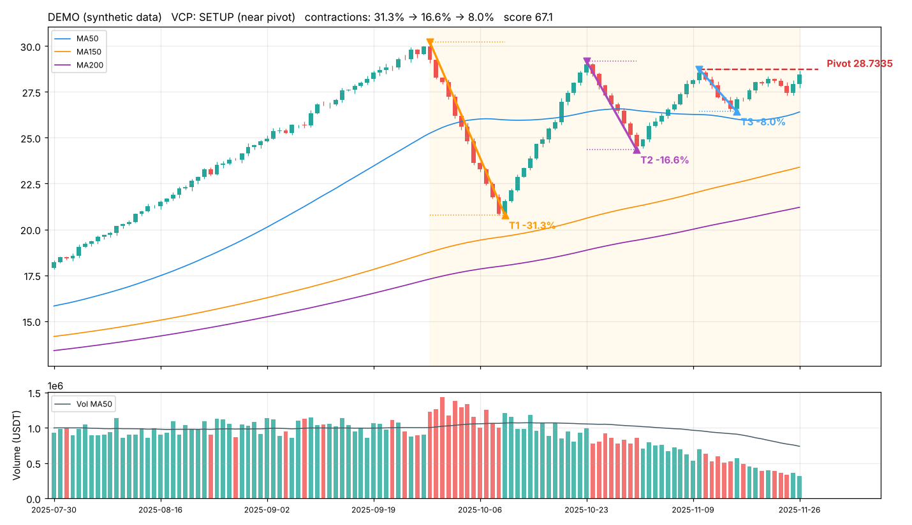
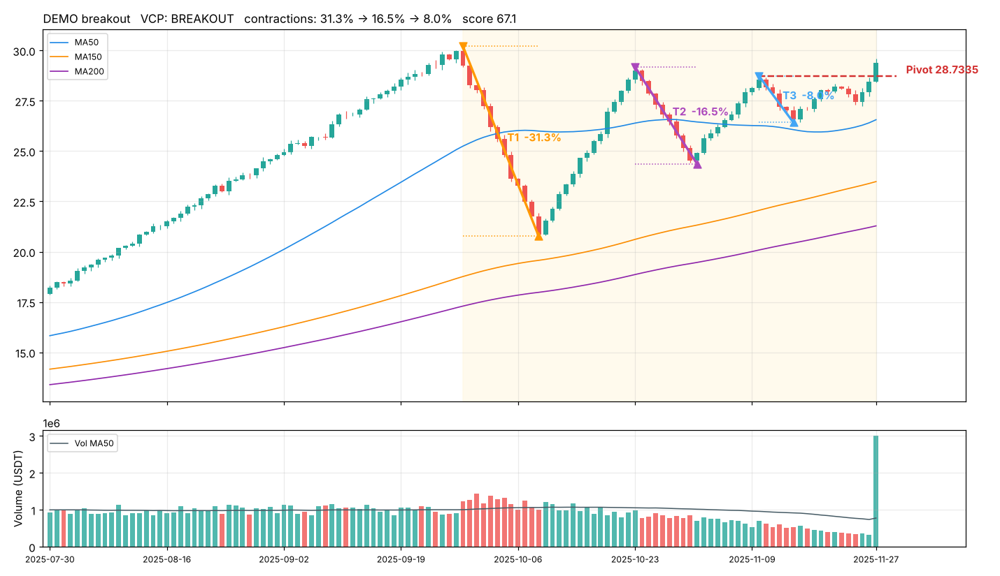

# VCP 自动扫描机器人（USDT 永续合约）

根据 **马克·米纳维尼（Mark Minervini）的波动收缩形态（VCP）**，自动扫描所有 USDT 本位永续合约，
把符合形态的币 **画成图**，并通过 **Telegram 推送提醒** 给你。

- 数据免费：Binance / Bybit / OKX / Gate 公开行情接口，**不需要注册、不需要 API Key**，连不上会自动换下一家
- 规则全部客观量化（见下方「判定规则」），没有主观判断
- 两种信号：
  - 👀 **SETUP**：形态成立，价格在突破点（pivot）下方 6% 以内 → 准备好，等突破
  - 🚀 **BREAKOUT**：收盘价带量（≥1.5 倍均量）突破 pivot → 突破信号
- 同一个信号只提醒一次，不会刷屏

| 形态成立（SETUP） | 带量突破（BREAKOUT） |
|---|---|
|  |  |

图里：黄色底色 = 底部区间；T1/T2/T3 = 每次收缩及回撤幅度；红色虚线 = Pivot 突破价；下方是成交量（可以看到逐步萎缩）。
（以上为模拟数据演示图）

---

## 小白一步一步来（Windows，约 15 分钟）

### 第 1 步：安装 Python
1. 打开 https://www.python.org/downloads/ ，点黄色按钮下载
2. 运行安装包，**一定要勾选最下面的 `Add python.exe to PATH`**，再点 `Install Now`

### 第 2 步：下载本程序
1. 在本 GitHub 页面点绿色 **Code** 按钮 → **Download ZIP**
2. 解压到一个好找的位置，例如 `D:\vcp`
3. 双击 **`1_install.bat`**，等它显示 `Done!`

> 现在就可以双击 **`2_scan_once.bat`** 试扫一次了。结果和图表保存在 `output` 文件夹。
> 如果显示“所有交易所都连接失败”，说明你的网络连不上交易所，需要开启代理/VPN（和你平时打开交易所网页一样）。

### 第 3 步：设置 Telegram 提醒（免费）
1. 在 Telegram 搜索 **@BotFather** → 发送 `/newbot` → 按提示起个名字
2. BotFather 会给你一串 **token**（像 `7123456789:AAHxxxx...`）
3. 用记事本打开 `config.yaml`，把 token 填进去：
   ```yaml
   telegram:
     bot_token: "7123456789:AAHxxxx..."
     chat_id: ""
   ```
4. 在 Telegram 里找到你刚建的机器人，点 **Start**，随便发一句 `hi`
5. 双击 **`5_telegram_test.bat`**，屏幕会显示 `chat_id = 123456789`
6. 把这个数字填进 `config.yaml` 的 `chat_id`，保存
7. 再双击一次 **`5_telegram_test.bat`**，Telegram 收到“提醒测试成功” ✅

### 第 4 步：让它一直自动扫描
双击 **`3_run_forever.bat`**，窗口保持打开即可，默认每 60 分钟扫一次，符合 VCP 就推送带图的提醒到 Telegram。

> 想单独看某个币为什么符合/不符合？双击 `4_check_one_symbol.bat`，输入如 `SOLUSDT`，会列出每条规则 ✅/❌ 并画图。

Mac / Linux：在终端运行 `./run_mac_linux.sh`

---

## 不想开着电脑？用 GitHub 免费云端自动跑（可选）

本仓库已包含 `.github/workflows/vcp-scan.yml`，每 4 小时自动扫描一次（UTC 00:10 日线收盘后必跑）。
1. 仓库页面 → **Settings → Secrets and variables → Actions → New repository secret**
2. 添加 `TELEGRAM_BOT_TOKEN` 和 `TELEGRAM_CHAT_ID` 两个 secret（值同第 3 步）。**不要把 token 直接写进仓库里的 `config.yaml`**，别人看到就能用你的机器人
3. 打开 **Actions** 页面 → 选 **VCP Scan** → **Run workflow** 手动试一次

注意：GitHub 的服务器在美国，Binance / Bybit 会拒绝美国 IP，程序会自动改用 OKX 或 Gate 的数据。
同一个币在各交易所的走势几乎一样，形态判断结果基本一致；你仍可在自己常用的交易所下单。
（私有仓库每月有 2000 分钟免费额度，按默认频率大约用 500 分钟左右。）

---

## 判定规则（全部可在 `config.yaml` 调整）

| # | 规则 | 默认值 | 说明 |
|---|---|---|---|
| 1 | **趋势模板**（第二阶段） | | Minervini Trend Template |
|   | 价格 > MA50 > MA150 > MA200 | | 多头排列 |
|   | MA200 向上 | 比 20 根前高 | |
|   | 价格高于 52 周低点 | ≥ 30% | |
|   | 价格距 52 周高点 | ≤ 25% | 接近新高的强势币 |
| 2 | **底部前已有上涨** | ≥ 30% | 先涨后整理 |
| 3 | **底部长度** | 15 ~ 180 根K线 | 底部起点 = 区间内最高点 |
| 4 | **收缩次数** | 2 ~ 6 次 | T2、T3、T4… |
| 5 | **回撤逐次缩小** | 每段 ≤ 上一段（容忍 10%），且末段 < 首段 | 例：30% → 15% → 7% |
| 6 | **首次回撤** | ≤ 35% | Minervini 原版标准 |
| 7 | **最后一次回撤** | ≤ 15% | 越紧越好 |
| 8 | **未跌破末段低点** | | 跌破即形态失败 |
| 9 | **成交量萎缩** | 末段均量 < 首段均量；最近 5 根均量 < 50 均量 | 卖压枯竭 |
| 10 | **Pivot** | = 最后一次收缩的高点 | 突破价 |
| 11 | **SETUP** | 现价在 pivot 下方 6% 内 | |
| 12 | **BREAKOUT** | 收盘 > pivot 且成交量 ≥ 1.5 倍 50 均量，且未超过 pivot 5% | 防止追高 |

**“一次收缩”怎么客观识别？**
用 ZigZag（摆动点，默认 4%）找出所有高低点；从底部最高点开始，每当价格反弹收回上一段跌幅的 ≥50%，
就视为一段新的收缩开始，否则只是下跌中的小反弹、并入当前这段。回撤幅度 = (该段高点 − 该段最低点) / 高点。

只使用 **已收盘** 的K线计算，信号不会因盘中波动而“重绘”。

### 常用调整
- 想要更多结果：`max_last_depth: 0.20`、`pivot_proximity_pct: 0.10`、`require_trend_template: false`
- 想要更严格：`require_higher_lows: true`、`min_contractions: 3`
- 想扫 4 小时图：`interval: 4h`，同时把 `year_bars` 改成 `2190`
- 只扫大币：`min_quote_volume_24h: 100000000`（1 亿 USDT）

---

## 输出文件
- `output/<时间>/signals.csv`：本轮 SETUP / BREAKOUT 信号
- `output/<时间>/all_results.csv`：所有币的判定明细和不符合原因
- `output/<时间>/*.png`：符合形态的币的图

## 文件说明
| 文件 | 作用 |
|---|---|
| `scanner.py` | 主程序 |
| `vcp/detector.py` | VCP 判定算法 |
| `vcp/data.py` | 各交易所免费行情接口 |
| `vcp/chart.py` | 画图 |
| `vcp/notify.py` | Telegram / Discord 提醒 |
| `config.yaml` | 所有设置 |
| `tests/` | 自动测试（`python -m pytest`） |

## 免责声明
本程序只是按客观规则识别图形并提醒，**不构成任何投资建议**。永续合约有杠杆，风险极高，请自行设置止损
（提醒里给出的“末段低点”可作为参考止损位）。
