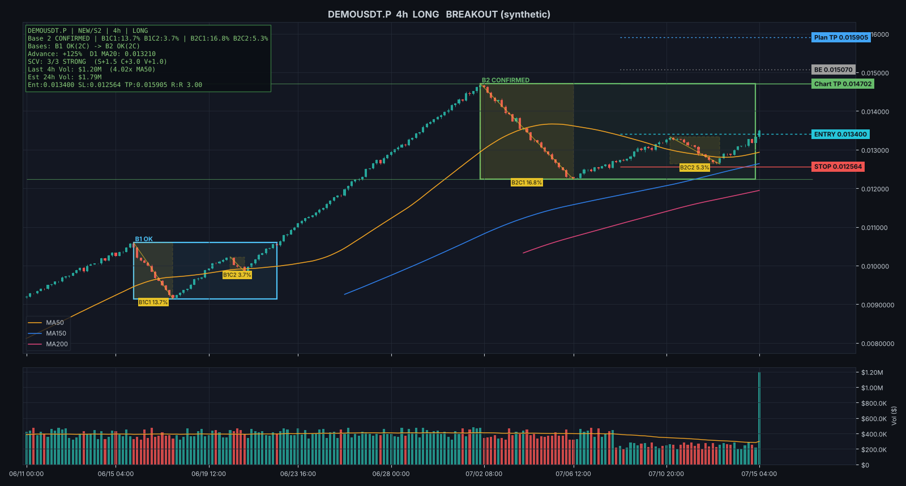

# VCP 自动扫描机器人（USDT 永续合约）

根据 **马克·米纳维尼（Mark Minervini）的波动收缩形态（VCP）**，自动扫描所有 USDT 本位永续合约：
**日线判断阶段（Stage 2）+ 4h / 1h / 30m 三个执行周期各自找 Base / 收缩 / 进场并各自打分**，把符合的币画成图，并通过 **Telegram** 推送和
“师父格式”一样的完整信号报告（Stage、Base 编号与历史、C 明细、SCV 打分、Entry/Stop/BE/TP、R:R、仓位、成交量、流动性）。

- 数据免费：Binance / Bybit / OKX / Gate 公开行情接口，**不需要注册、不需要 API Key**，连不上会自动换下一家
- 规则全部客观量化（见下方「判定规则」），没有主观判断
- 两种信号：
  - 👀 **SETUP**：当前 Base 已确认，价格在 Entry 下方 3% 内 → 挂突破单
  - 🚀 **BREAKOUT**：4h 收盘站上 Entry → 突破
- 同一个信号只提醒一次；每次扫描还会用同一套规则 **回放历史**，把过去真实触发的案例连图带报告发给你



方框 = Base（B1、B2…）；黄色虚线框 = 每段收缩（B2C1 16.8%）；右侧标签 = Entry / Stop / BE / Plan TP / Chart TP；
左上角 = 信息面板；下方 = 4h 成交额与 50 均线。（模拟数据演示图）

---

## 小白一步一步来（Windows，约 15 分钟）

### 第 1 步：安装 Python
1. 打开 https://www.python.org/downloads/ ，点黄色按钮下载
2. 运行安装包，**一定要勾选最下面的 `Add python.exe to PATH`**，再点 `Install Now`

### 第 2 步：下载本程序
1. 在本 GitHub 页面点绿色 **Code** 按钮 → **Download ZIP**
2. 解压到一个好找的位置，例如 `D:\vcp`
3. 双击 **`1_install.bat`**，等它显示 `Done!`

> 现在就可以双击 **`2_scan_once.bat`** 试扫一次了。结果和图表保存在 `output` 文件夹。
> 如果显示“所有交易所都连接失败”，说明你的网络连不上交易所，需要开启代理/VPN（和你平时打开交易所网页一样）。

### 第 3 步：设置 Telegram 提醒（免费）
1. 在 Telegram 搜索 **@BotFather** → 发送 `/newbot` → 按提示起个名字
2. BotFather 会给你一串 **token**（像 `7123456789:AAHxxxx...`）
3. 用记事本打开 `config.yaml`，把 token 填进去：
   ```yaml
   telegram:
     bot_token: "7123456789:AAHxxxx..."
     chat_id: ""
   ```
4. 在 Telegram 里找到你刚建的机器人，点 **Start**，随便发一句 `hi`
5. 双击 **`5_telegram_test.bat`**，屏幕会显示 `chat_id = 123456789`
   （或者在 Telegram 搜索 **@userinfobot**，点 Start，它回复的 `Id` 就是你的 chat_id。
   ⚠️ chat_id **不是** token 冒号前面那串数字，那是机器人自己的 ID）
6. 把这个数字填进 `config.yaml` 的 `chat_id`，保存
7. 再双击一次 **`5_telegram_test.bat`**，Telegram 收到“提醒测试成功” ✅

### 第 4 步：让它一直自动扫描
双击 **`3_run_forever.bat`**，窗口保持打开即可，默认每 60 分钟扫一次，符合 VCP 就推送带图的提醒到 Telegram。

> 想单独看某个币为什么符合/不符合？双击 `4_check_one_symbol.bat`，输入如 `CTRUSDT`，会输出完整信号报告、没有触发的原因、历史回放结果，并画图。

Mac / Linux：在终端运行 `./run_mac_linux.sh`

---

## 不想开着电脑？用 GitHub 免费云端自动跑（可选）

本仓库已包含 `.github/workflows/vcp-scan.yml`，每 4 小时自动扫描一次（3 个执行周期每次约 7 分钟；私有仓库每月免费 2000 分钟，这样约用 1300 分钟）。
1. 仓库页面 → **Settings → Secrets and variables → Actions → New repository secret**
2. 添加 `TELEGRAM_BOT_TOKEN` 和 `TELEGRAM_CHAT_ID` 两个 secret（值同第 3 步；chat_id 可用 @userinfobot 查到）。**不要把 token 直接写进仓库里的 `config.yaml`**，别人看到就能用你的机器人
3. 打开 **Actions** 页面 → 选 **VCP Scan** → **Run workflow** 手动试一次，Telegram 会收到一条「📊 VCP 扫描完成」汇总
4. **定时自动运行只在默认分支（main）上生效**：代码必须合并到 `main`，GitHub 才会每 4 小时自动跑

注意：GitHub 的服务器在美国，Binance / Bybit 会拒绝美国 IP，程序会自动改用 OKX 或 Gate 的数据。
同一个币在各交易所的走势几乎一样，形态判断结果基本一致；你仍可在自己常用的交易所下单。
（如果把仓库设成公开就没有分钟数限制，可以改回更密的频率；token 放在 Secrets 里不会公开。）

---

## 判定规则（全部可在 `config.yaml` 的 `strategy:` 段调整）

### 1. Stage 2（日线，Minervini 趋势模板 8 条）
| # | 条件 |
|---|---|
| 1 | 价格 > MA150 且 > MA200 |
| 2 | MA150 > MA200 |
| 3 | MA200 向上至少 1 个月（Minervini 更偏好 4~5 个月） |
| 4 | MA50 > MA150 且 > MA200 |
| 5 | 价格 > MA50 |
| 6 | 价格 ≥ 52 周低点 × 1.30 |
| 7 | 价格 ≥ 52 周高点 × 0.75 |
| 8 | **RS 相对强度 ≥ 70**：每次扫描把所有币按“近 3 个月 40% + 前三个季度各 20%”的涨幅排名（1~99） |

- 上市不足 200 天的币（标记 **NEW**）算不出 MA200，只用算得出来的均线（MA150 / MA50 / MA20）
- **前期涨幅 ≥ 100%（翻倍）** 是加分项；设 `require_advance: true` 可变成硬性条件（比 Minervini 更严）

### 2. Base 与收缩（每个执行周期各自计算：4h / 1h / 30m）
- 从起涨低点开始数 Base：价格从高点回撤 ≥ 8% 开始一个 Base，**收盘重新突破 Base 高点** 时结束
- **B1、B2、B3 都能做（B3 得分最低），B4 起判定失效**（标记 LATE，不提醒）
- 每个 Base 内：**C1 = Base 最高点 → 回调最低点**；之后每段收缩的 **低点必须比上一段高**，
  没抬高的（跌破了前面的低点）说明还是同一次回调，自动并入前一段，所以不会出现一堆 C
- **执行周期的均线必须多头排列：MA50 > MA150 > MA200**，否则不提醒（师父：小周期的 VCP 必须在多头排列里）。
  价格不一定要站在均线上方（师父的 BTW / UAI / NMR 价格都在 MA50 下面），但三条均线的顺序必须是多头；
  价格也站上三条均线时 S 再加 0.5（Close确认排列）。`require_ma_stack: false` 可关闭
- 结构合格：至少 2 段收缩、逐段变小（容忍 10%）、**C1 ≤ 35%**；末段 > 10% 不算不合格，但会半仓
- 不合格标记：WIDE（C1 太深）、FAIL（没有逐段变小）、FORMING（收缩还不够 2 段）、LATE（第 4 个及以后的 Base）
- 各周期默认：4h 拉 900 根K线、挂单缓冲 0.5%；1h 拉 600 根、0.5%；30m 拉 600 根、0.25%（和师父一样）

### 3. 进场 / 止损 / 出场
| 项目 | 规则 |
|---|---|
| Pivot | 当前 Base 最后一段收缩的高点 |
| Entry 入场 | Pivot × (1 + 0.5% 挂单缓冲) |
| Stop 止损 | 最后一段收缩低点 × (1 − 0.5%)；**入场风险 > 10% 不做**（Minervini：单笔止损不超过 10%） |
| R | Entry − Stop |
| Chart TP 结构止盈 | 最近一段时间的最高点（上方前高阻力；4h 看 180 根，1h / 30m 看 240 根） |

出场方案（`exit_profile`，默认 `minervini`）。**历史回放会对同一批入场把三种都算一遍**，汇总里直接对比哪种在加密货币上表现更好：

| 方案 | 保本 | 减仓 | 剩余仓位 |
|---|---|---|---|
| `minervini` | +2R 止损移到入场价 | +3R 卖 50%（逢强卖出） | 收盘跌破“20 日均线”离场（4h 用 MA120、1h 用 MA480…） |
| `master`（师父报告的参数） | +0.8R | — | +5R 全部止盈 |
| `qullamaggie`（公开资料整理，非官方） | 减仓时 | 持有 3 天后若盈利卖 50% | 收盘跌破“10 日均线”离场 |

### 4. SCV 扣分制（从师父 9 个信号报告反推，7 个做多例子全部对得上）
VCP 事后看到处都是（“万物皆可 VCP”），拿历史成功案例来看只会自我安慰。真正有用的是 **在当下给形态打分，低分的不做**。

**Score 满分 3 分**：S（结构）、C（收缩）、V（成交量）三项各自加减分，最后每项 **正数 +1、0 记 0、负数 −1**，三项相加。
“走满分、慢慢扣分”就是：哪一项有问题，那一项就从 +1 掉到 0 或 −1。

| 项 | 规则 |
|---|---|
| **S 结构** | Stage2 +1.0（不在 Stage2 −2.0）；执行周期收盘 > MA50 > MA150 > MA200（Close确认排列）+0.5；RS < 70 −1.0；**均线混乱**：多头排列连续不到 20 根 −1.0、MA50 比 MA200 高不到 1%（缠绕）−1.0、MA50 走平/向下 −0.5 |
| **C 收缩** | C1 在 20%~35% 记 0，**C1偏小（< 20%，洗盘不够深）−0.5**；Base确认 +1.0 / Base未确认 +0.5；**第 1 个 Base +0.5、第 2 个 +1.5、第 3 个 0**（B4 起失效）；Pivot突破 +1.0；最近 3 根有长上影线 −1.0 |
| **V 成交量** | 最近 10 根有放量阳线（≥ 1.3 倍 MA50）“近期阳放” +1.0；有放量阴线“阴足放量” −2.0；**都没有 = 0（无量，拿不到这 1 分）**；最近 24h 成交额 < 100 万 USDT −2.0 |

对照师父的例子：

| 币 | S | C | V | Score | 评级 |
|---|---|---|---|---|---|
| AEROUSDT 4h | +1.5 | +2.5（C1=20.7%、确认、第1Base、突破） | +1.0（近期阳放） | 3 | STRONG |
| SOONUSDT 15m | +1.5 | +1.5（C1=21.4%、未确认、第3Base、突破） | 0 | 2 | GOOD |
| PHAUSDT 30m | +1.5 | +1.0（C1=25.6%、未确认、第1Base） | 0 | 2 | GOOD |
| NMRUSDT 1h | +1.0 | +1.0（C1=21.6%、未确认、第1Base） | 0 | 2 | GOOD |
| CTRUSDT 4h | +1.5 | +3.0（C1偏小、确认、第2Base、突破） | −2.0（阴足放量） | 1 | GOOD |
| UAIUSDT 15m | +1.0 | +2.0（C1=22.0%、未确认、第1Base、突破） | −2.0 | 1 | GOOD |
| BTWUSDT 30m | +1.0 | +0.5（C1=32.7%、未确认、第3Base） | −2.0 | 1 | GOOD |

| Score | 评级 | 默认 |
|---|---|---|
| 3 | STRONG | 提醒 |
| 1~2 | GOOD | 提醒（`min_score: 1`） |
| 0 | FAIR | 不提醒 |
| 负数 | WEAK | 不提醒 |

**Base 确认（CONFIRMED）**：结构合格，且末段收缩的低点之后已守住 5 根K线、并反弹过末段的一半；否则是 UNCONFIRMED（WAIT）。
**仓位**：末段收缩 > 10% 或入场风险 > 10% → 半仓（HALF_SIZE，师父的规则）。

**怎么检验扣分制有没有用**：历史回放会把所有 VCP 突破都模拟一遍（不管分数高低），按 Score 和执行周期分组列出胜率和平均 R，
并对比“高分照做”和“低分不做”两组。如果高分组没有明显比低分组好，就说明扣分规则要调整。

### 5. 仓位与流动性
- 名义仓位 = 账户 × 每笔风险% ÷ Risk%（打到止损只亏 1%）；最多 5 倍杠杆
- 末段收缩 > 10% 或入场风险 > 10% → 半仓（HALF_SIZE）；分数低于 `min_score` → SKIP（不做）
- 单笔上限 Liquidity Cap = 最新 4h 成交额 × 10%；估算 24h 成交额 = 成交额 50 均线 × 6
- 仓位规则名称：`NEW_LISTING_` / `MATURE_` + `NORMAL_SIZE` / `HALF_SIZE` / `SKIP`

只使用 **已收盘** 的K线计算，信号不会因盘中波动而“重绘”。

### 历史回放（验证规则）
每次扫描都会对每个币、每个执行周期回放最近 300 根K线（4h 约 50 天、1h 约 12 天、30m 约 6 天），**逐根只用当时看得到的数据**：
当时形态合格、价格向上碰到 Entry → 按 Entry（跳空则按开盘价）成交，分数按突破那根K线收盘时计算，然后按出场方案管理。
**所有突破都会模拟，不管分数高低**，汇总里按 Score 和执行周期分组列出胜率和平均 R，用来检验“高分是不是真的比低分好”；
单独推送的 **最近 3 个案例** 只挑高分（会做的），每个都附图和当时的完整信号报告。
统计不含手续费、资金费率和滑点；历史成功不代表未来。

### 规则来源与“后来者”
- 趋势模板、VCP（收缩逐段变小、末段量缩、Pivot 突破）、10% 最大止损、保本与逢强卖出：来自 Mark Minervini 的
  *Trade Like a Stock Market Wizard* / *Think & Trade Like a Champion*（本程序参数取自公开的整理资料，个别数字各来源略有出入，例如 52 周低点有写 25% 也有写 30%，这里用书中的 30%）
- 后来者：Oliver Kell（2020 美国投资冠军赛 +941%）、J Law（2024 年 +353.9%，破了 Minervini 2021 年 +334.8% 的纪录）、
  Kristjan Kullamägi（Qullamaggie，收益为自述，未经比赛核实）。他们都是在 Minervini/O'Neil 的基础上加了更短线的进出场，
  **但冠军赛是单年成绩、组别不同，不能证明谁的方法长期更好**。所以这里不直接替换，而是把更短线的出场方式做成可选方案，用历史回放在加密货币数据上实际比较

### 常用调整
- 想要更多信号：`min_score: 0`、`near_entry_pct: 0.05`、加上 15m（`exec_tfs: [4h, 1h, 30m, 15m]`）
- 想要更严格：`min_score: 2`、`max_bases: 2`、`min_contractions: 3`
- 只扫大币：`min_quote_volume_24h: 100000000`（1 亿 USDT）
- 账户资金和每笔风险：`account:` 段

## 多个账号接收通知
`config.yaml` 里 `telegram.chat_id` 可以填多个，用英文逗号分隔，例如 `"123456789,1134208027"`。
GitHub Secrets 里的 `TELEGRAM_CHAT_ID` 也会一起收到。每个账号都要先在 Telegram 里打开机器人点 **Start**。

## 输出文件
- `output/<时间>/signals.csv`：本轮 SETUP / BREAKOUT 信号
- `output/<时间>/all_results.csv`：所有币的判定明细和不符合原因
- `output/<时间>/*.png`：符合形态的币的图（含交易计划线）
- `output/<时间>/validation_trades.csv`：历史回放的每一笔模拟交易

## 文件说明
| 文件 | 作用 |
|---|---|
| `scanner.py` | 主程序 |
| `vcp/engine.py` | 多周期 VCP 引擎：Stage、Base 编号、SCV、交易计划、历史回放 |
| `vcp/detector.py` | ZigZag 与收缩拆分 |
| `vcp/report.py` | 信号报告文字（师父格式） |
| `vcp/data.py` | 各交易所免费行情接口 |
| `vcp/chart.py` | 画图（Base 方框、收缩框、价位线、信息面板） |
| `vcp/notify.py` | Telegram / Discord 提醒 |
| `config.yaml` | 所有设置 |
| `tests/` | 自动测试（`python -m pytest`） |

## 免责声明
本程序只是按客观规则识别图形并提醒，**不构成任何投资建议**。永续合约有杠杆，风险极高，请自行设置止损
（提醒里给出的“末段低点”可作为参考止损位）。
